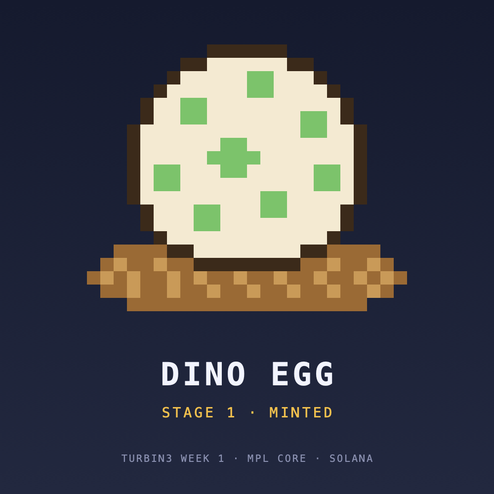
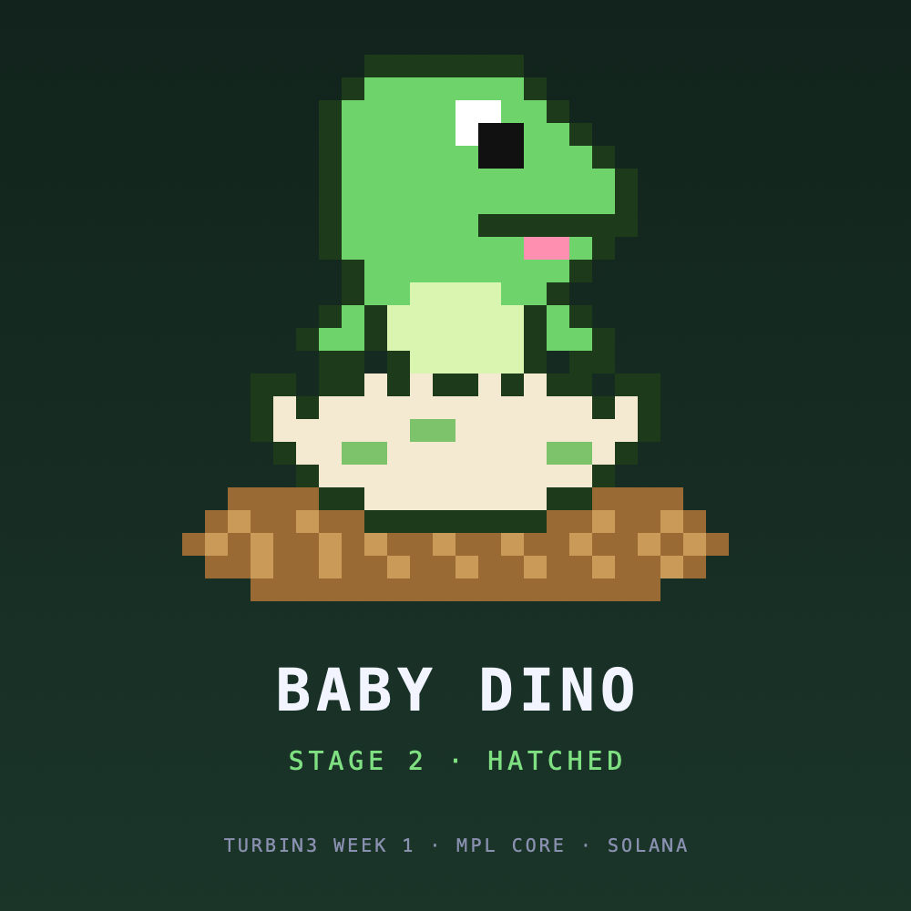
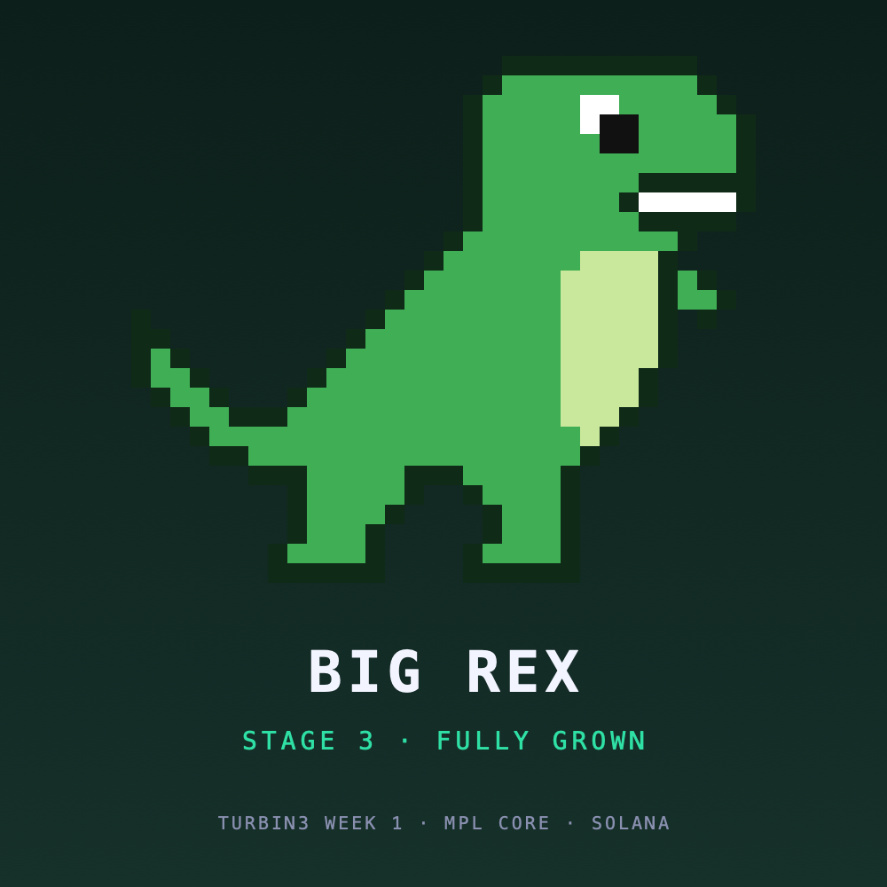
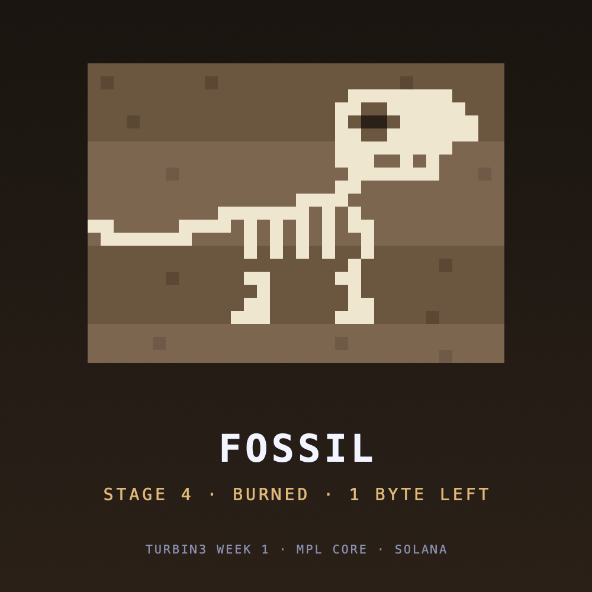
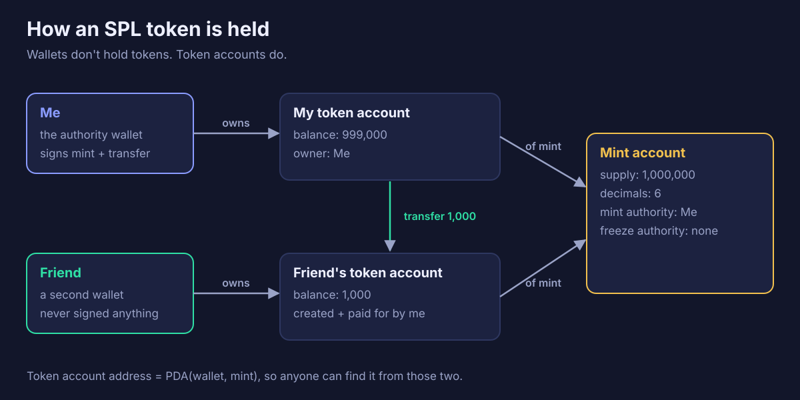
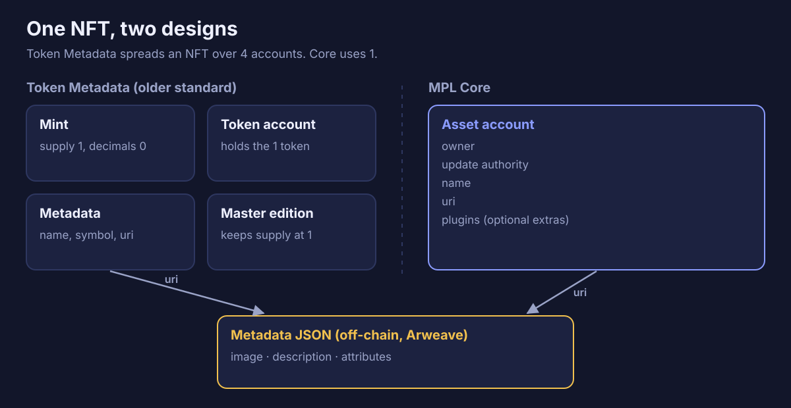
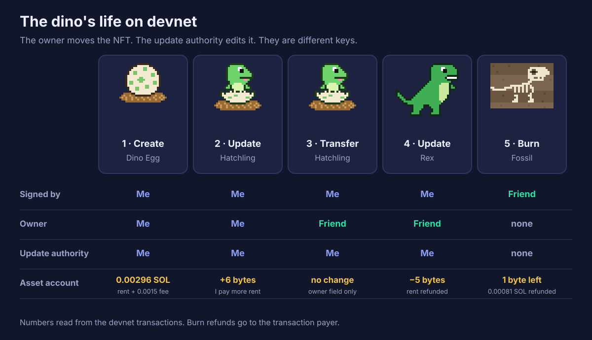

# I raised a dino on Solana

_What I learned about tokens and NFTs in week 1 of the Turbin3 builders cohort._

This week's assignment had five parts: mint and transfer my own token, mint an NFT, update it, transfer it, and finally burn it to get my rent back.

I didn't want five unrelated scripts, so I turned them into one story. My NFT starts as a dino egg. It hatches, moves to a new home, grows into a rex, and ends up a fossil.

|            Egg             |               Hatchling                |            Rex             |              Fossil              |
| :------------------------: | :------------------------------------: | :------------------------: | :------------------------------: |
|  |  |  |  |

Here's what I did and what I learned along the way.

## The one idea that makes it all click

On Solana, **everything is an account**. Your wallet is an account. A token is an account. An NFT is an account. Programs are accounts too, but they hold code and no state.

Programs don't keep data inside themselves. They read and write separate data accounts. To keep an account alive, you deposit a small amount of SOL called **rent**. You get it back when the account is closed.

Once I understood this, everything else in the week made sense.

## Part 1: My own SPL token

A token on Solana has two kinds of accounts.

- **The mint account** describes the token: total supply, number of decimals, and who is allowed to mint more (the _mint authority_).
- **Token accounts** hold balances. My wallet doesn't hold tokens directly. It owns a token account that does.

Each wallet has one standard token account per token, called the **Associated Token Account**. Its address is derived from the wallet address and the mint address, so anyone can find it without asking.

Here's what I did:

1. **Created the mint.** This took two instructions in one transaction. The first creates an empty 82-byte account. The second turns it into a mint with 6 decimals and me as mint authority. I set no freeze authority, so nobody can ever freeze holders' tokens.
2. **Minted 1,000,000 tokens** into my own token account.
3. **Sent 1,000 tokens** to a second wallet. That wallet had no token account yet, so my transaction created one for it, and I paid the rent. The receiver didn't have to sign anything.

One detail surprised me: **amounts are always whole numbers**. With 6 decimals, "1 token" is stored as `1000000`. Decimals only change how wallets display the number.

## Part 2: NFTs with Metaplex Core

An NFT is a one-of-one item with an owner and some metadata. The older Solana standard (Token Metadata) builds one out of four accounts: a mint with supply 1, a token account to hold it, a metadata account, and a master edition account to keep the supply at 1.

**Metaplex Core** puts everything into **one account**: the owner, the update authority, the name and a URI. That makes it simpler and cheaper. Metaplex [puts a Core asset at about 0.0029 SOL](https://developers.metaplex.com/core/create-asset), versus about 0.022 SOL for Token Metadata.

The image, description and traits aren't stored on-chain. They live in a JSON file, and the account only stores the link to it (the URI). I uploaded my images and JSON files to Arweave using Irys.

## Part 3: Raising the dino

The most important thing I learned about Core is that **an NFT has two separate roles**:

- The **owner** can transfer it and burn it.
- The **update authority** can change its name and metadata.

They can be different wallets. My dino's life shows why that matters.

1. **Create.** I minted the egg. I was both the owner and the update authority.
2. **Update.** As update authority, I changed the name to "Hatchling" and pointed the URI to new metadata. The egg hatched.
3. **Transfer.** I sent the dino to my second wallet (call it Friend). The transfer only changed the `owner` field in the account. Nothing else moved.
4. **Update again.** My favourite part: Friend owned the dino now, but **I grew it into a rex**. I was still the update authority, and owning an NFT doesn't give you the right to edit it.
5. **Burn.** Friend, as the owner, burned it. My wallet paid the transaction fee, so Friend didn't need any SOL.

## Following the lamports

I logged every balance before and after each step (1 SOL = 1 billion lamports). Four things surprised me:

- **The account resizes on update.** The hatchling's name and link were 6 bytes longer than the egg's, so the account grew and I paid a little more rent. The rex's were 5 bytes shorter than the hatchling's, so it shrank and I got some rent back.
- **Creating a Core asset includes a fee.** The asset cost 0.00296 SOL. About half was rent, and 0.0015 SOL was [Metaplex's protocol fee](https://developers.metaplex.com/protocol-fees), which sits in the asset account.
- **Burning doesn't delete the account.** Core shrinks it to **1 byte**, and that byte marks the address as used forever, so no new asset can ever be created there. That's my fossil. It keeps the rent for 1 byte plus the protocol fee.
- **The refund goes to the payer, not the owner.** Burning freed 0.00081 SOL of rent. It went to my wallet, because I paid for the transaction, even though Friend owned the dino.

## Why this is interesting

The owner and the editor being different people opens up a lot of ideas:

- **Game characters that level up.** The game is the update authority. It evolves your character, while you stay the owner and can trade it.
- **Membership passes and certificates.** A pass that upgrades from Bronze to Gold, or a course certificate that updates as you finish each week.
- **Event tickets that become collectibles.** After the event, the organizer updates the ticket into a souvenir.
- **Burn to redeem.** Burn a voucher NFT to claim a reward, and the rent comes back to whoever pays for the transaction.

SPL tokens are the base layer for points, rewards and stablecoins. They're all mints and token accounts underneath.

## What I'd tell someone starting

- Think in accounts. Ask "which account stores this, and who pays its rent?"
- Read the balances, not just the logs. The lamports told me more than any tutorial.
- Owner and update authority are different powers. Decide who should hold each one.

The code, with links to every devnet transaction, is on GitHub: [0zKillua/solana-turbine/week1](https://github.com/0zKillua/solana-turbine/tree/main/week1).

Next week: more Turbin3. 🦖
