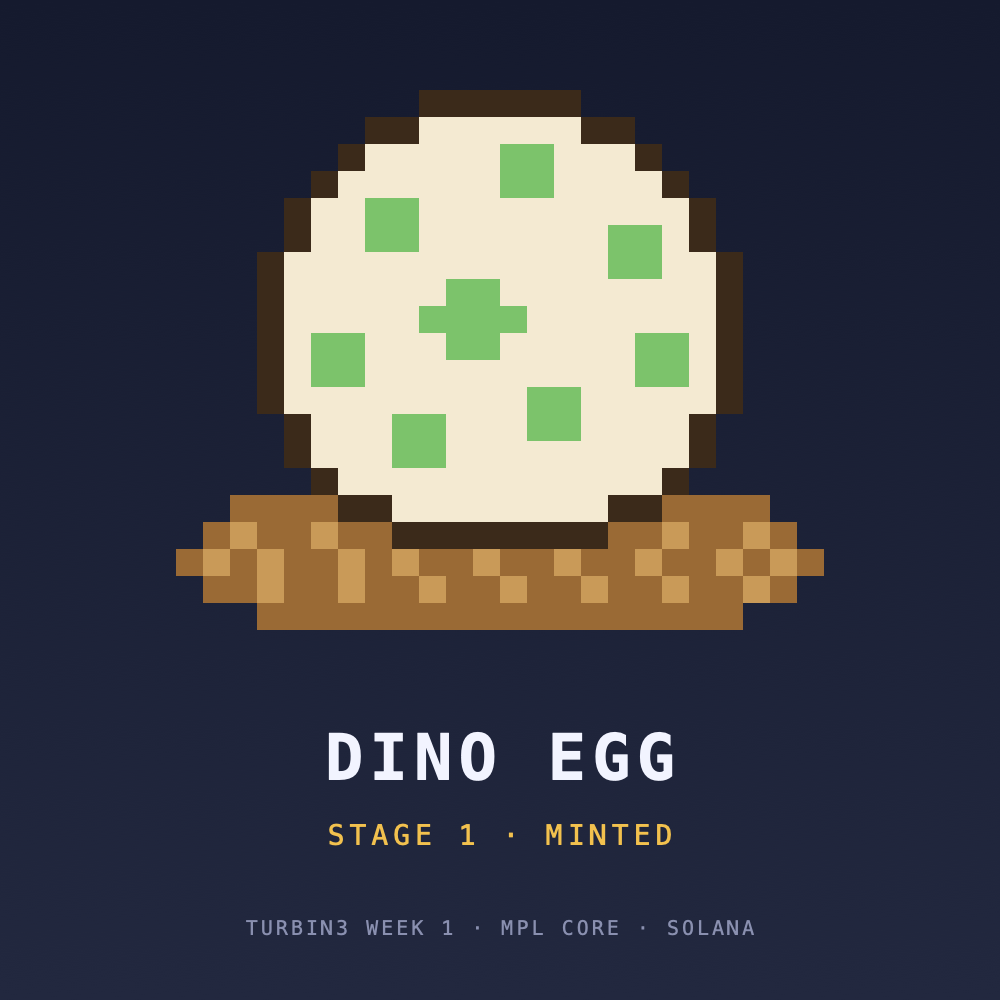
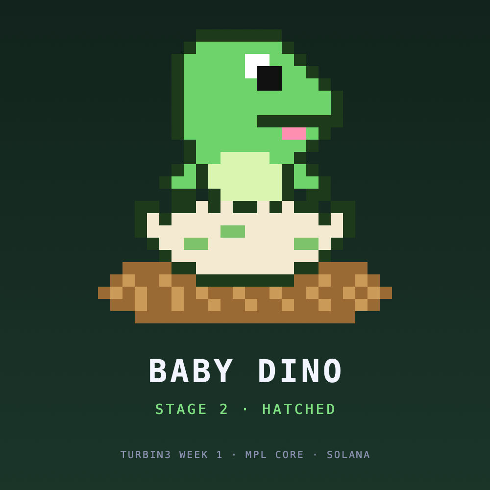
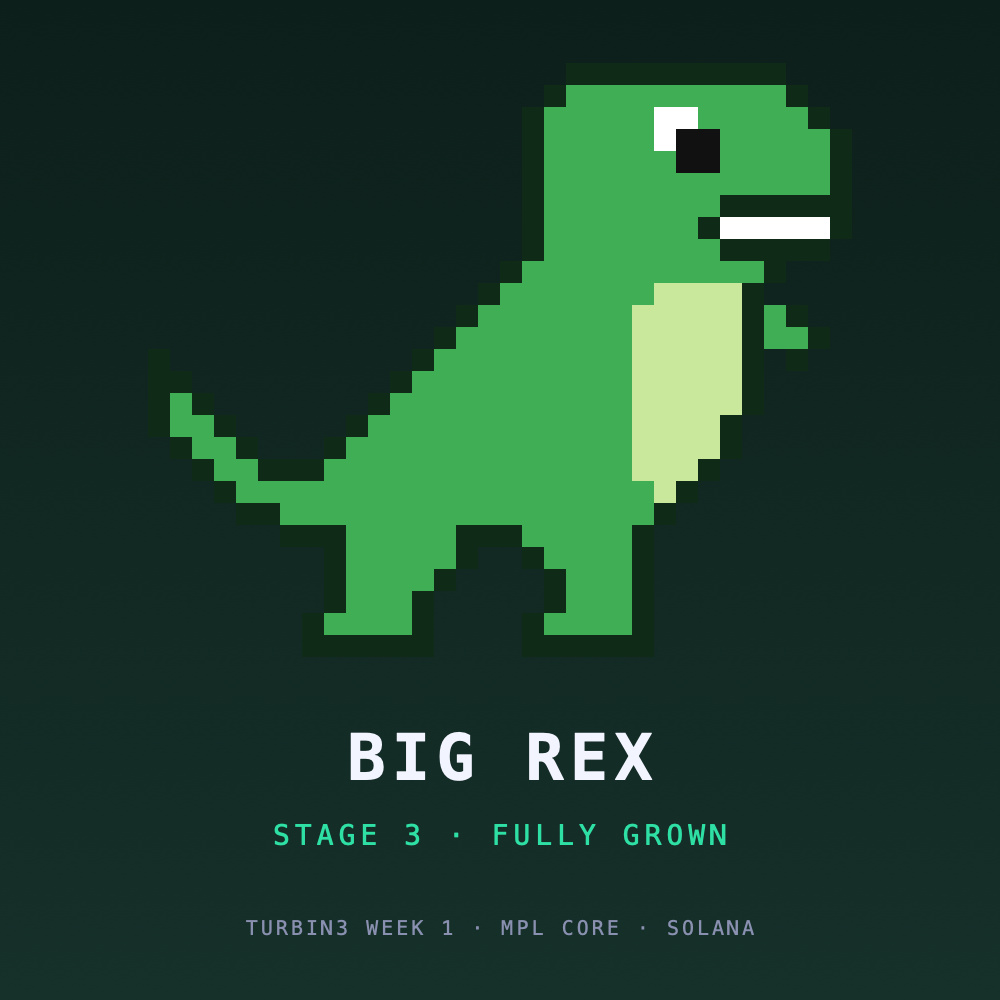
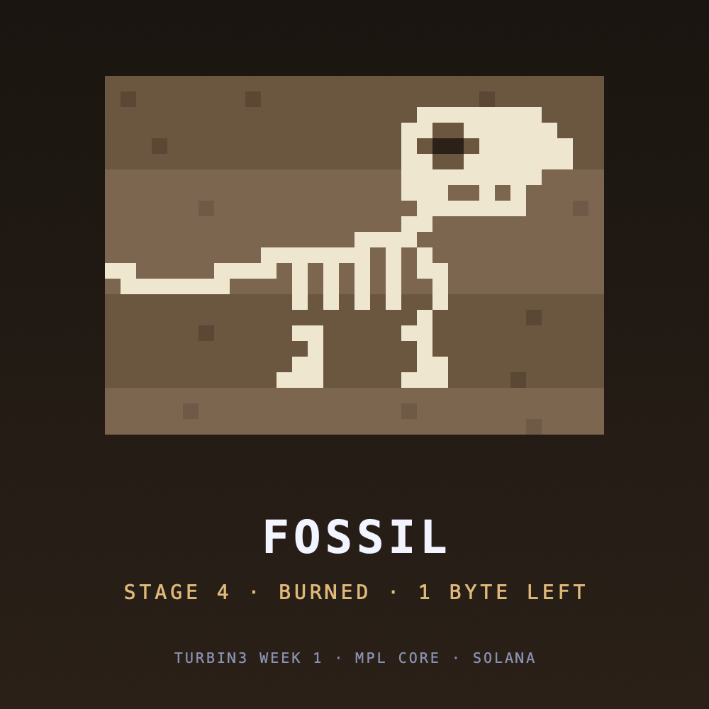

# Week 1: SPL Token and MPL Core NFT

TS scripts that:

1. Create an SPL token, mint it, and transfer it to another wallet.
2. Mint an NFT with Metaplex Core.
3. Update the NFT's name and metadata as its update authority.
4. _(extension)_ Transfer the NFT to another wallet.
5. _(extension)_ Burn the NFT and reclaim its rent.

The NFT is a dino that grows up across these steps. It is minted as an egg, the update hatches it, the transfer gives it a new owner, a second update grows it into a rex while someone else owns it, and the burn leaves a fossil.

|         Egg (mint)         |           Hatchling (update)           | Rex (update after transfer) |          Fossil (burn)           |
| :------------------------: | :------------------------------------: | :-------------------------: | :------------------------------: |
|  |  |   |  |

Write-up: [I raised a dino on Solana](ARTICLE.md)

## Devnet proof

Every script records what it created in [`deployments/devnet.json`](deployments/devnet.json).

**Wallets**

| Role                                                        | Address                                                                                                              |
| ----------------------------------------------------------- | -------------------------------------------------------------------------------------------------------------------- |
| Authority (fee payer, mint authority, NFT update authority) | [`DNTGUgwR…4dqhaq`](https://explorer.solana.com/address/DNTGUgwRWPhTKjWrqTeYLZSHGpprbi7p2dUoPG4dqhaq?cluster=devnet) |
| Recipient                                                   | [`Hr98auWN…9kgX3w`](https://explorer.solana.com/address/Hr98auWNM3ahp3a3LF874Jb5Por3ZWQuzc2TfU9kgX3w?cluster=devnet) |

**Task 1: SPL token**

| Step                                          | Result                                                                                                               | Transaction                                                                                                                                           |
| --------------------------------------------- | -------------------------------------------------------------------------------------------------------------------- | ----------------------------------------------------------------------------------------------------------------------------------------------------- |
| Create mint (6 decimals, no freeze authority) | [`CQYY5qbr…E4FRJz`](https://explorer.solana.com/address/CQYY5qbrL9Yq1i5pjNUaFKh2wtHE9oVD18dUosE4FRJz?cluster=devnet) | [`7WXhMKKW…`](https://explorer.solana.com/tx/7WXhMKKW9YHSoKDafxftJb8EBwtcrkd262YrJy2NcBjwV9fnqLRnp4Pw46chSz1F9jLxXDx3urp5Qf9HQk7nLV2?cluster=devnet)  |
| Mint 1,000,000 tokens to the authority        | supply 1,000,000                                                                                                     | [`2QX4z58C…`](https://explorer.solana.com/tx/2QX4z58CZr3akyMoW7zEQCDqbzYirKdfw2pMJhpgkDwiTxfxnV65EVHe6GxFSXNVB8CJiwZFRP2FX12gGgstdEyo?cluster=devnet) |
| Transfer 1,000 tokens to the recipient        | 999,000 / 1,000                                                                                                      | [`2A3jap5Y…`](https://explorer.solana.com/tx/2A3jap5YETmsNJiiULTokD4wXTxiuqd2FnbJ2tTg2DozVkgbdceaBbZHzMApPYqipqmNJEp9t4DEYYtZNkcjpMcp?cluster=devnet) |

**Tasks 2–5: Core NFT** [`7p6rjKjc…7gh6noh`](https://explorer.solana.com/address/7p6rjKjcjFX57ZydXheEknfsuzpwjHwWGnQjM7gh6noh?cluster=devnet)

| Task | Step                                                                      | Name after              | Owner after | Transaction                                                                                                                                           |
| ---- | ------------------------------------------------------------------------- | ----------------------- | ----------- | ----------------------------------------------------------------------------------------------------------------------------------------------------- |
| 2    | Create                                                                    | Turbin3 Dino Egg        | authority   | [`4hsND9t6…`](https://explorer.solana.com/tx/4hsND9t6RUCUwAfvxW8wcNCLxpqKReAhx2B8AcXKwBJV2TRraXdpfv5McroXbXuUuL5UEfGzZTDfbxmnk1g77WMv?cluster=devnet) |
| 3    | Update (hatch)                                                            | Turbin3 Dino: Hatchling | authority   | [`ToHyKuyc…`](https://explorer.solana.com/tx/ToHyKuycfYuQ9f9swpTGTUpc4a2V63iaC51YjJmQoRAxL5ohBkz8N2nupHXG5tDkouVMr2agD1AEQRwAzPSgsyc?cluster=devnet)  |
| 4    | Transfer                                                                  | Turbin3 Dino: Hatchling | recipient   | [`2ZE1X1UC…`](https://explorer.solana.com/tx/2ZE1X1UCqGN6P7ao3HGhV9mqUWxMpirsHjhoCarjjBfmmfwLChvNcaf19eV58Jj6578j1sqtv1tqhaQy6yuPhDMs?cluster=devnet) |
| 3    | Update (grow), signed by the update authority while the recipient owns it | Turbin3 Dino: Rex       | recipient   | [`9jetDDzJ…`](https://explorer.solana.com/tx/9jetDDzJUbfzEFVLNh47CUUz9PPzAxnQPoaTNrVye7HPczui7ZPLuz61HszNEmmXfZ3ApaHj4seV9sv8REfYTRS?cluster=devnet)  |
| 5    | Burn, signed by the recipient as owner                                    | burned                  | none        | [`2oP1jGy9…`](https://explorer.solana.com/tx/2oP1jGy9XBUDPzxJgyyVB8W5NU55rfRrfe9GZyqYmxLLvRnVt1tMN8jFBa89RgLeRAX2DEfi3u3HocANXix6nekP?cluster=devnet) |

## How it works

**SPL token**

- A mint is an account holding supply, decimals and the mint authority.
- Wallets don't hold tokens. Each wallet gets an Associated Token Account per mint.
- Amounts are integers: with 6 decimals, 1 token is `1_000_000`.

**Core NFT**

- One account holds the whole NFT: owner, update authority, name and URI.
- The owner can transfer and burn. Only the update authority can edit. That's why the rex update worked while the recipient owned the dino.
- A burn leaves a 1-byte "fossil" account, so the address can't be reused.

## What it cost

| Step     | Lamports                                                                                                      |
| -------- | ------------------------------------------------------------------------------------------------------------- |
| Create   | 1,463,040 rent + 1,500,000 [Core protocol fee](https://developers.metaplex.com/protocol-fees)                 |
| Update   | Account resizes: a longer name costs rent, a shorter one refunds it                                           |
| Transfer | Only the transaction fee                                                                                      |
| Burn     | 812,800 rent returned to the **payer** (not the owner). The 1-byte fossil keeps its rent and the protocol fee |

## Run it

Needs Node 22+, pnpm and a funded Solana CLI wallet (`~/.config/solana/id.json`).

```bash
pnpm install
pnpm wallets              # creates the recipient wallet

pnpm spl:create-mint
pnpm spl:mint
pnpm spl:transfer

pnpm nft:upload
pnpm nft:create
pnpm nft:update hatchling
pnpm nft:transfer
pnpm nft:update rex
pnpm nft:burn
```

Set `CLUSTER` in `.env` to change networks (see [`.env.example`](.env.example)).
